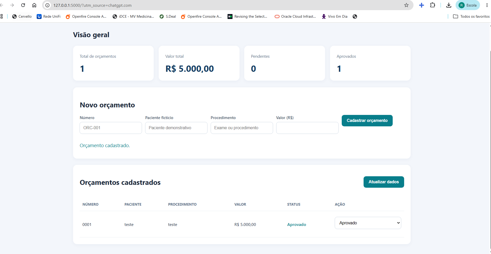

# 🏥 Gestão Hospitalar

### Sistema demonstrativo de gestão de orçamentos hospitalares

Aplicação web desenvolvida com Python, Flask, SQLite, HTML, CSS e JavaScript, com foco em cadastro, acompanhamento e visualização de orçamentos.

## 📸 Sobre o projeto

Este projeto é uma representação independente, desenvolvida para fins de portfólio, inspirada em uma experiência prática de desenvolvimento e implantação de sistemas em ambiente hospitalar em Rondonópolis - MT.

A experiência prática envolveu desenvolvimento, integração com banco de dados, configuração de servidor e disponibilização de funcionalidades de gestão e relatórios.

Este repositório não contém o código proprietário nem dados internos da instituição.

## 🚀 Funcionalidades

- Cadastro de orçamentos.
- Consulta de registros.
- Atualização de status.
- Dashboard com indicadores.
- Total de orçamentos.
- Soma dos valores cadastrados.
- Acompanhamento de orçamentos pendentes e aprovados.

## 🛠️ Tecnologias

| Tecnologia | Utilização |
|---|---|
| Python 3.13 | Backend |
| Flask | API e servidor web |
| SQLite | Banco de dados |
| HTML5 | Estrutura da interface |
| CSS3 | Estilização |
| JavaScript | Interatividade |
| Git | Versionamento |

## 🏗️ Arquitetura

```text
GESTAO_HOSPITALAR_PORTFOLIO/
│
├── backend/
│   └── app.py
│
├── frontend/
│   └── index.html
│
├── database/
│   └── gestao.db
│
├── requirements.txt
├── .gitignore
└── README.md
```

## 💻 Como executar

1. Clone o repositório:

```bash
git clone https://github.com/Rays3107/gestao-hospitalar-portfolio.git
```

2. Entre na pasta:

```bash
cd gestao-hospitalar-portfolio
```

3. Crie um ambiente virtual:

```bash
python -m venv .venv
```

4. Instale as dependências:

```bash
pip install -r requirements.txt
```

5. Execute:

```bash
python backend/app.py
```

6. Acesse:

http://127.0.0.1:5000

## 👩‍💻 Desenvolvimento

Projeto desenvolvido como demonstração de conhecimentos em desenvolvimento web, integração de sistemas, persistência de dados e construção de interfaces administrativas.

## ⚠️ Aviso

Aplicação demonstrativa. Utilize exclusivamente dados fictícios. Não insira informações reais de pacientes ou dados institucionais.

---

**Desenvolvido por Rayse Kawane**  
GitHub: [@Rays3107](https://github.com/Rays3107)
## 📸 Capturas de tela

### Painel principal


